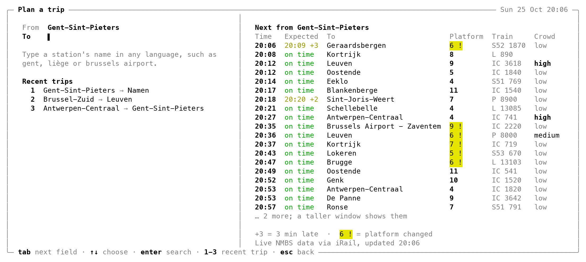
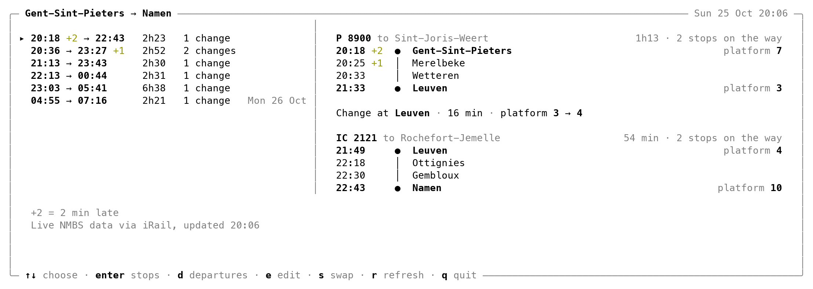
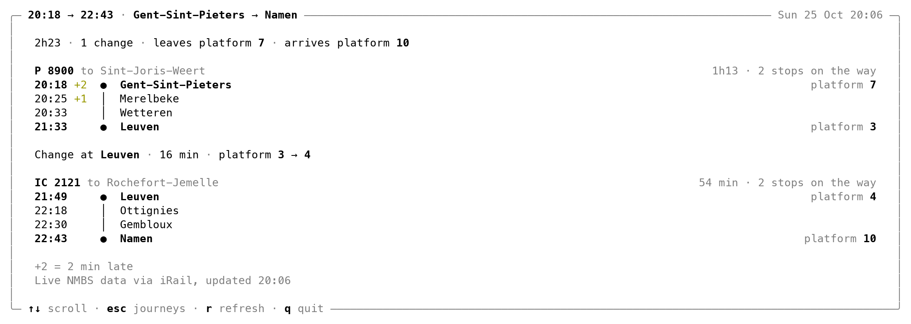
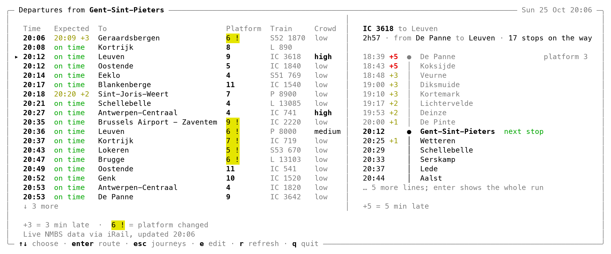
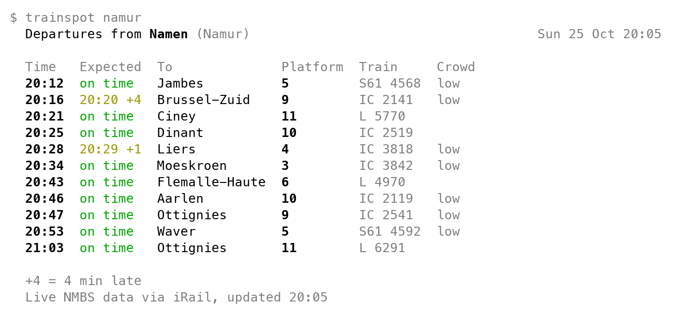
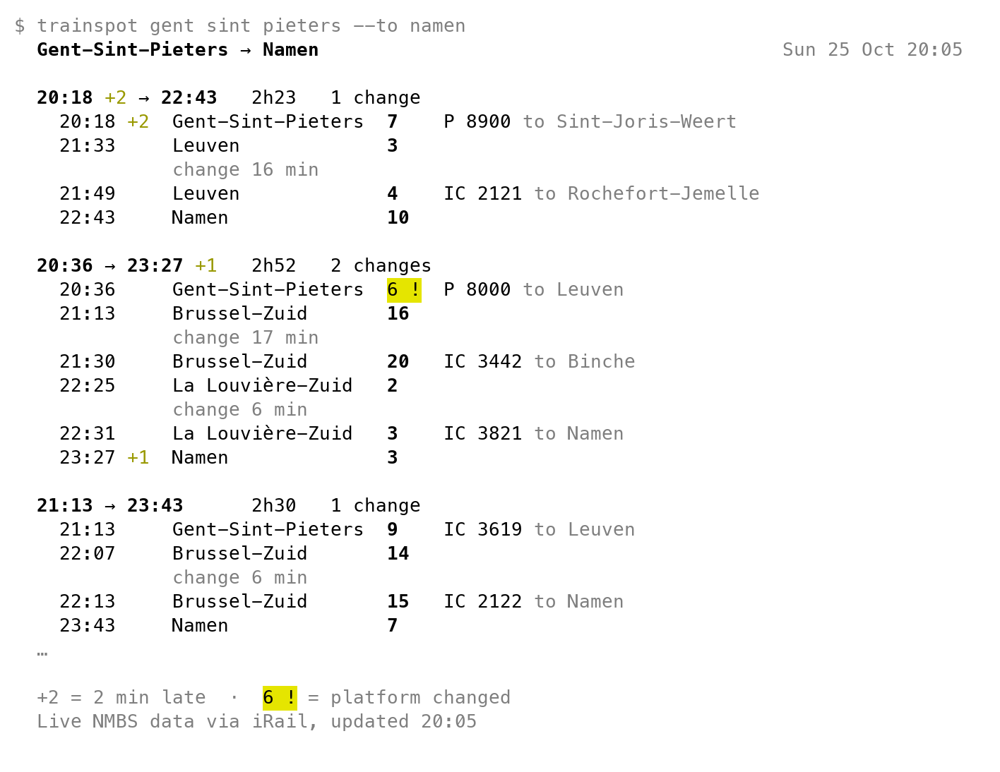

# trainspot

Live NMBS train departures and journeys for any station in Belgium, right in your terminal.

```sh
go install github.com/PieterLuypaert/trainspot@latest
```

This needs Go 1.26 or newer. Run `trainspot -h` for every option.

```sh
trainspot                                 # plan a trip on a full screen
trainspot gent sint pieters               # the departure board of Gent-Sint-Pieters
trainspot gent sint pieters --to aarlen   # the next journeys from Gent to Arlon
trainspot mons                            # Bergen and Mons are the same station
trainspot liège-guillemins --lang fr      # station names in French: nl, fr, en or de
```

## The trip screen

<picture>
  <source media="(prefers-color-scheme: dark)" srcset="docs/screenshots/trip-dark.png">
  
</picture>

Plain `trainspot` opens a full screen to plan a trip. Type where you leave from and
where you are going, and it suggests stations as you type, in any of the four languages.
Pick one with the arrow keys and enter, or tab to the other field. Under the form stand
your recent trips, each picked with its number, and beside it the next departures from
where you leave.

<picture>
  <source media="(prefers-color-scheme: dark)" srcset="docs/screenshots/journeys-dark.png">
  
</picture>

Once both stations are set, enter shows the next journeys; in a wide window the chosen
journey's route line stands beside them, in a narrow one under them.

<picture>
  <source media="(prefers-color-scheme: dark)" srcset="docs/screenshots/stops-dark.png">
  
</picture>

On the journeys, enter shows every stop of the chosen journey down a route line: per
train how long it rides and how often it stops, a dot where you get on and off with its
platform, a bar for each station on the way and a diamond where the train is now, and
for each change the time you have and the platforms to walk between. A stop the train
skips, or where it now ends, is marked. When the journey's first train has left,
trainspot keeps following its trains live.

<picture>
  <source media="(prefers-color-scheme: dark)" srcset="docs/screenshots/departures-dark.png">
  
</picture>

`d` shows the departure board of where the trip starts; there, choose a train with the
arrow keys to see its whole run and where it is now, beside the board in a wide window
or with enter in a narrow one. `s` swaps the two stations, `e` edits them and `r`
fetches everything again; it also refreshes by itself every minute. trainspot remembers
your last five trips in `~/.config/trainspot` and opens on the last one the next time,
so your daily trip is one word away.

## Departures

<picture>
  <source media="(prefers-color-scheme: dark)" srcset="docs/screenshots/board-dark.png">
  
</picture>

For every departure the board shows when it is planned and when it really leaves:
on time, the new time with the minutes late, cancelled or departed. Next to that come
the destination, the platform (black on yellow when it changed), the train and how
busy NMBS expects it to be. Delays of five minutes or more are red. A legend explains
the marks on the board, and on a narrow terminal the least important columns make way.

## Journeys

<picture>
  <source media="(prefers-color-scheme: dark)" srcset="docs/screenshots/journeys-cli-dark.png">
  
</picture>

With `--to`, trainspot lists the next journeys between two stations. Every word after
`--to` names the destination, so no quotes are needed. Each journey shows when it
leaves and arrives, how long it takes and how many changes it has, and below that
every stop with its platform and train and the time you have to change.

trainspot counts the delays into each change. When they leave too little time, it
says so: `change 2 min, tight` in yellow, or `change missed by 4 min` in red when the
next train leaves before you arrive. A walk between two stations is part of the change
after it, cancelled trains are marked, and a journey that leaves after today starts
with its day.

## Station names

Station names work in Dutch, French, English and German, with or without accents,
so `luik`, `liège` and `liege` all find the stations of Liège. When a name fits several
stations, such as `gent` or `brussel`, trainspot lists them with their local names
and asks which one you mean. Typos get suggestions.

## In scripts

Without a terminal, plain `trainspot` prints its help and exits with 2. Piped into
another command, trainspot prints plain text. In a terminal, `--no-color`
drops the colours and keeps only bold and dim text. Without a terminal to answer, a name that
fits several stations makes trainspot list them and exit with 2. Problems at iRail
exit with 1.

## Data

The departures and journeys come live from the [iRail API](https://docs.irail.be),
which serves the NMBS's own data. trainspot keeps the list of stations for a week in
`~/.cache/trainspot` and the last trip of the screen in `~/.config/trainspot`.
